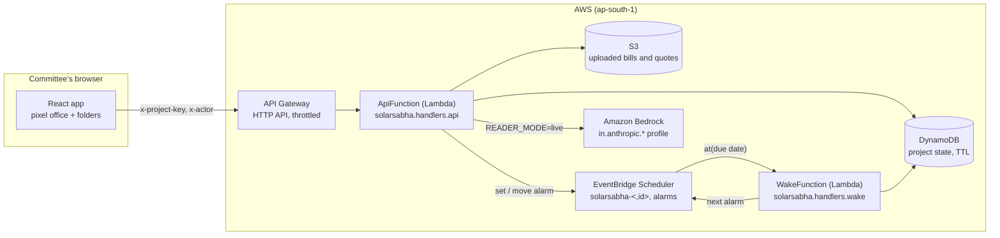
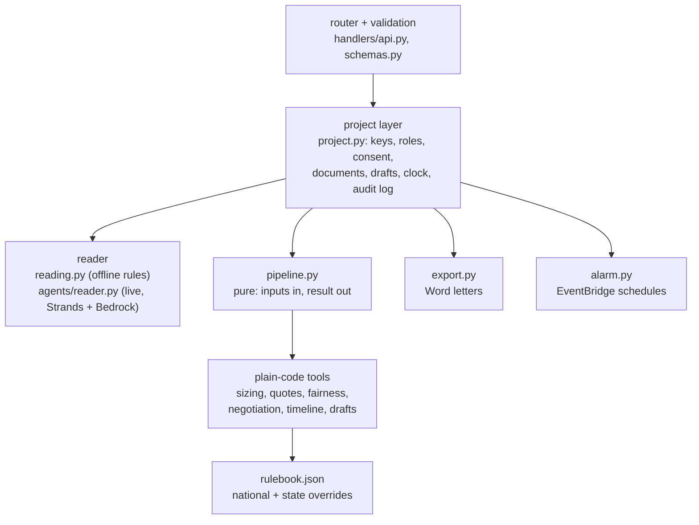
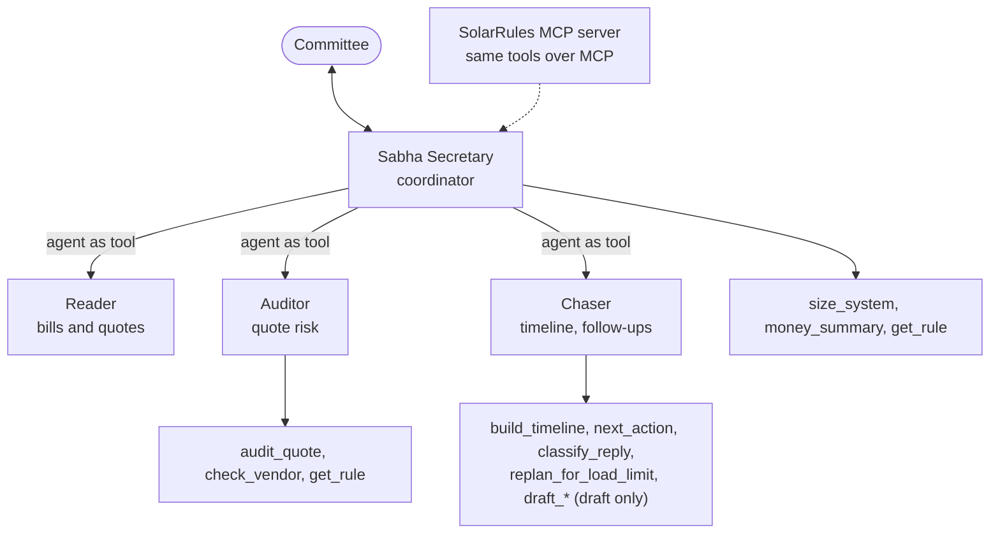
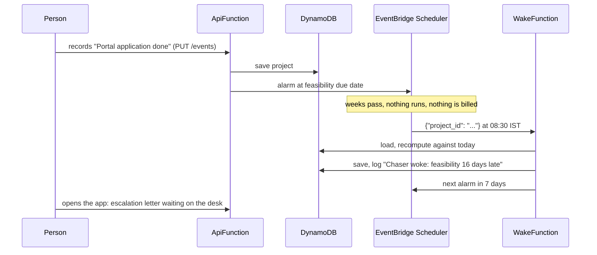
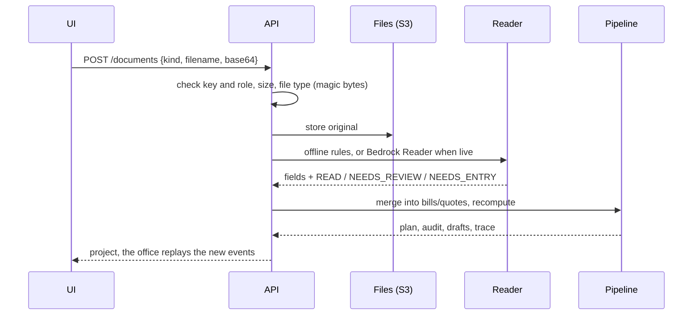
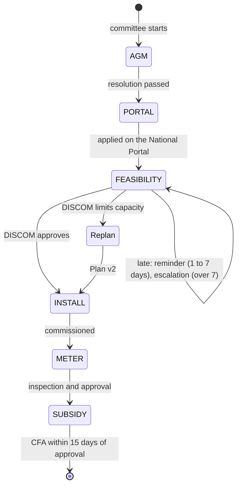

# Architecture

## Components

Inside the API Lambda:

## The agents

The Planner is not an agent: sizing is plain code. Agents read, explain and draft; tools calculate. In the offline mode
the same tools run without a model, and the office shows the same events.

## How the agent waits weeks

The demo's time machine moves a separate, labelled offset (`sim_offset_days`) through the same recompute.

## A document upload

## Project stages

## Project record (one DynamoDB item, `pk=PROJECT#<id>`, `sk=STATE`)

| Field | Content |
|---|---|
| `key_hash` | SHA-256 of the access key (never returned) |
| `consent`, `expires_at`, `ttl` | privacy record and retention |
| `members` | names and roles |
| `inputs` | society, bills, quotes, flat areas |
| `assumptions` | committee overrides (tariff, cost, yield, share) |
| `documents` | uploaded files: status, reader, notes, fields |
| `events`, `started_on`, `sim_offset_days` | real dates of progress; simulated offset |
| `discom_reply` | pasted DISCOM email |
| `draft_state` | edits and approvals by stable draft id |
| `audit` | activity log (last 500) |
| `result` | latest pipeline output (plan, audit, timeline, drafts, trace, rulebook) |
| `alarm_at` | when the Chaser wakes next |

## Plain code vs AI
| Plain code (tested, exact) | AI (judgement, language) |
|---|---|
| sizing, money, CO2, fairness, price per kW, vendor check, payment-term flags, injection scan, timeline status, chase level, draft facts, offline text reading | reading photos and scans, explaining flags in plain words, polishing draft wording, classifying messy DISCOM replies |
